# State machines

Every lifecycle in the product. Transitions not drawn here are not allowed. The backend
rejects them with `409 invalid_transition` and names the current state.

## ModelVersion

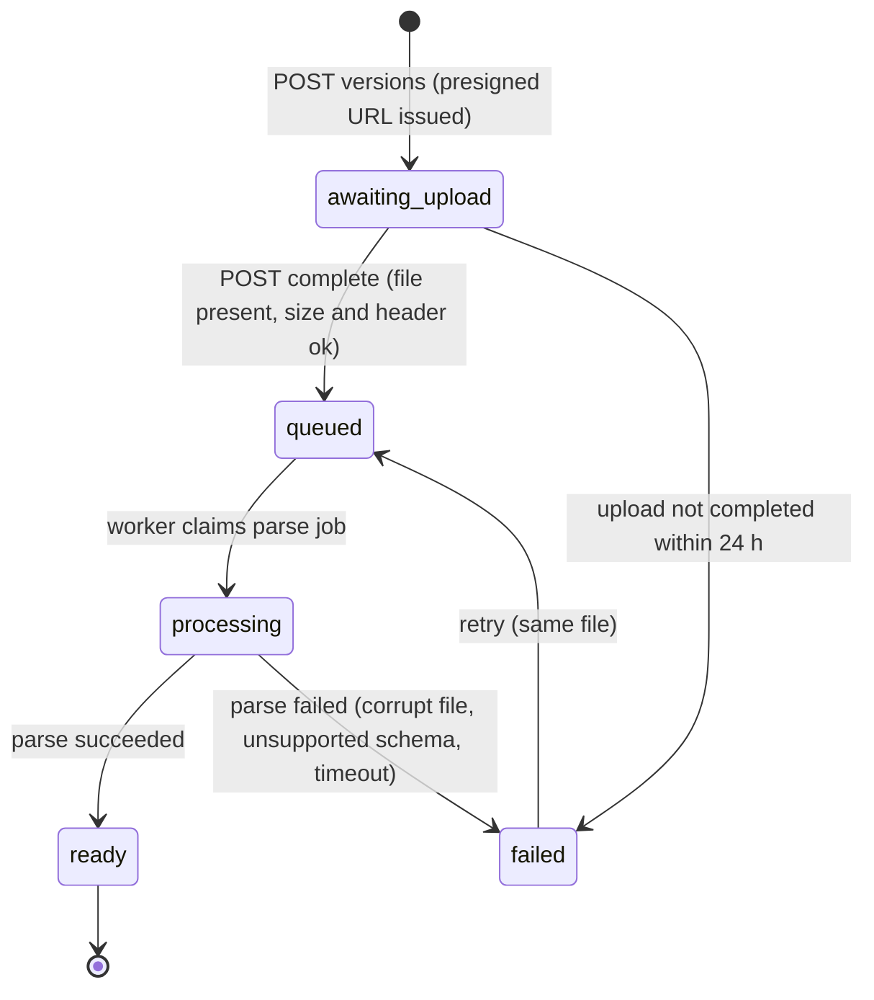

- A `ready` version is immutable. Deleting is allowed only when no run references it (then it
  is soft-deleted).
- **Same content hash:** if a `ready` version with the same sha256 exists anywhere in the
  same org, the parse artifacts are reused and the version goes straight to `ready` (event
  still recorded).
- `failed.error.code`: `not_ifc`, `unsupported_schema`, `corrupt_file`, `too_large`,
  `parse_timeout`, `parse_error`.

## Job

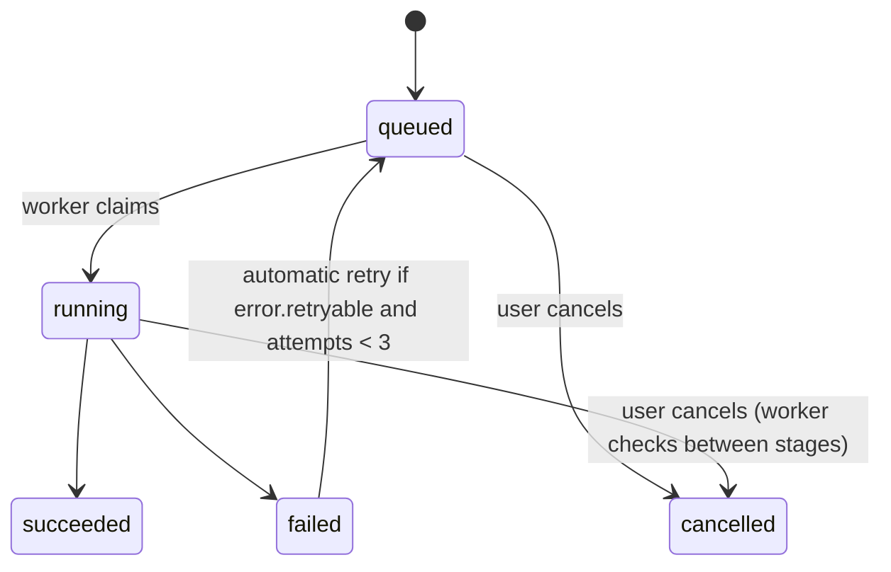

A job never "needs input" (P13). It always ends.

## Run

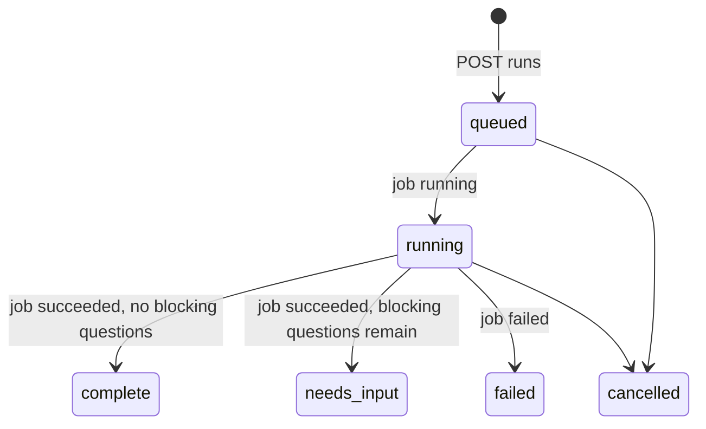

Runs are immutable once finished. Answering a question doesn't change a run. The UI offers
"Re-generate", which creates a new run with the current decisions and adjustments. The
revision's `currentRunId` moves to the newest **finished** run (complete or needs_input).

## BoqRevision (working and saved versions, P29)

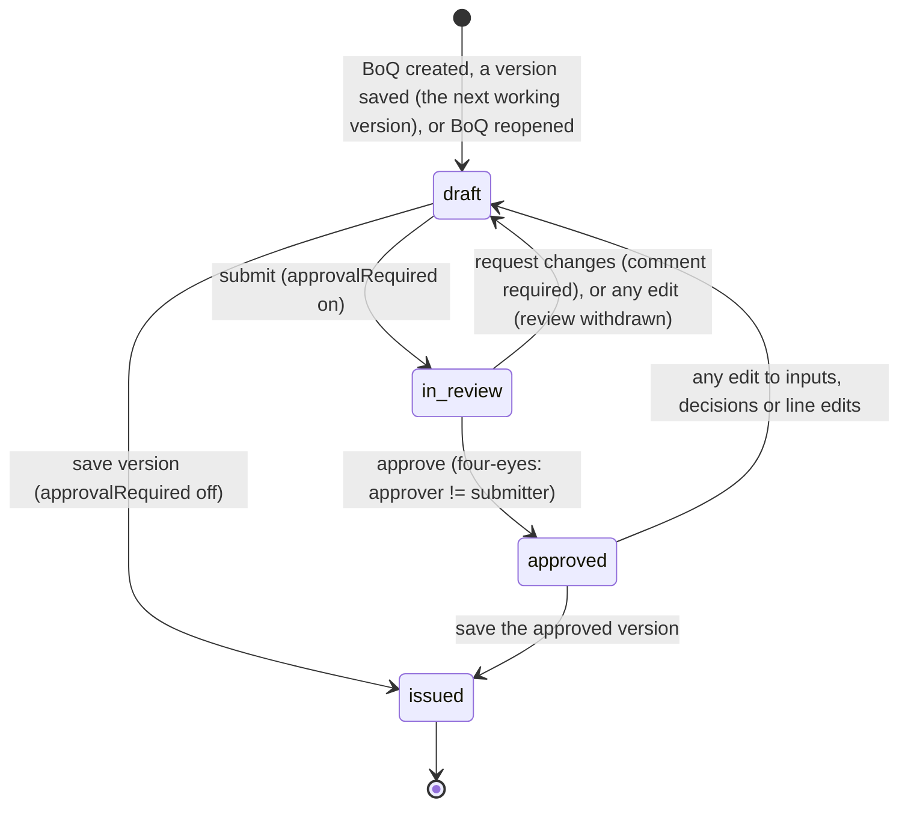

Rules:
- `draft` is the **working version**, shown as "Working"; `issued` is a **saved version**,
  shown as "Saved". Review states exist only when the org has `approvalRequired` on.
- **Edits allowed only in `draft`.** Changing inputs, line edits, manual lines or project
  decisions that the current run uses, while `in_review` or `approved`, sends it back to `draft`
  (the UI warns first). Decisions are project-wide, so one answer can reopen several revisions;
  the UI lists which.
- **Save / submit preconditions:** `currentRunId` set, that run finished, and it uses the
  current inputs, decisions and line edits (no pending changes). Blocking questions don't
  prevent saving; their count is stored on the version (P29).
- **Saving** freezes: the run id, a copy of the line edits and manual lines, the position
  numbers, an Excel export, and a `frozen` record. Nothing about a saved version can change
  afterwards (`409 revision_locked`), not even by an org owner. In the same transaction the next
  `draft` revision is created with the same inputs (`basedOnRevisionId` = the saved one), unless
  the save was part of confirming the BoQ.
- A BoQ has at most one non-saved revision at a time.

## Boq

```mermaid
stateDiagram-v2
  [*] --> working
  working --> confirmed: confirm (saves a final version first if the working one changed)
  confirmed --> working: reopen (lead, reason; a new working version from the last saved one)
```

- `confirmed`: every write to the BoQ returns `409 boq_confirmed`; its saved versions,
  exports and share links keep working. Archiving the project makes all its BoQs read-only
  whatever their state.

## Session (BR-54)

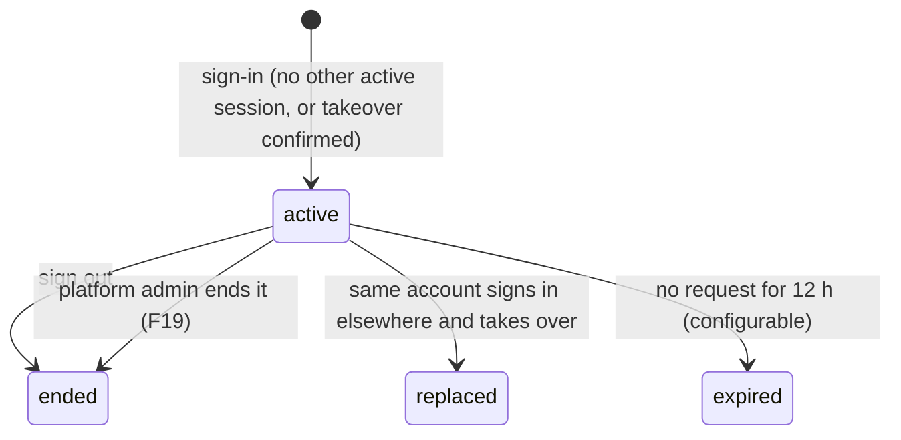

- A sign-in while another session is `active` returns `409 session_active` until the user
  confirms the takeover. A replaced session's next request returns `401 session_replaced`.

## ShareLink

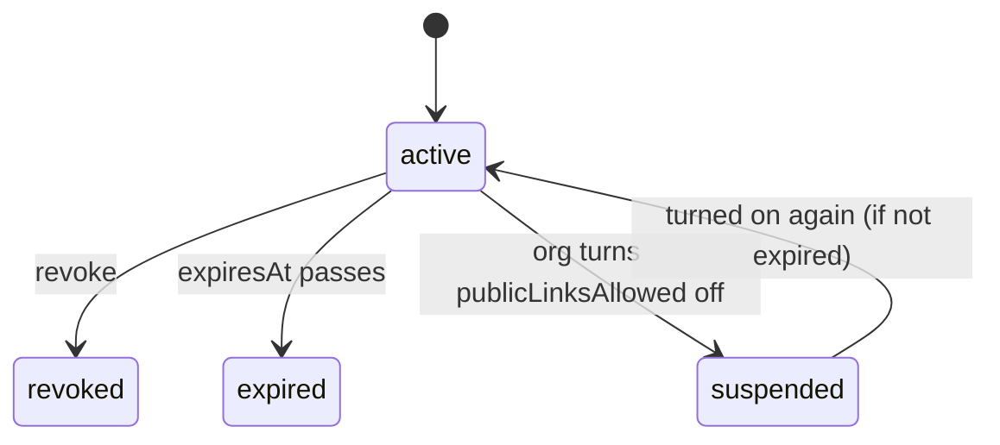

## Pricing module (P36)

These belong to the module and live with its own code; the core has none of them.

### VendorLink

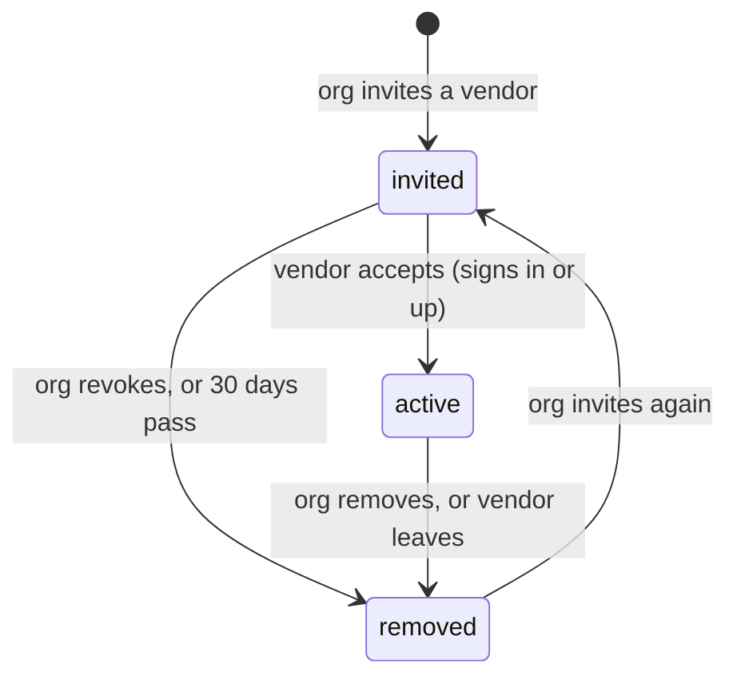

### OfferRequest

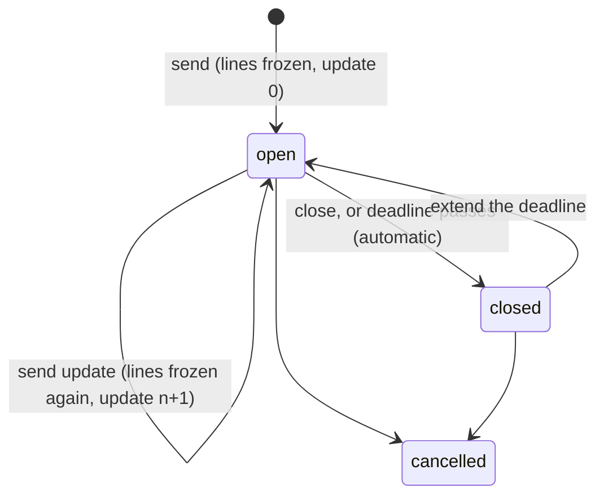

### OfferInvitation

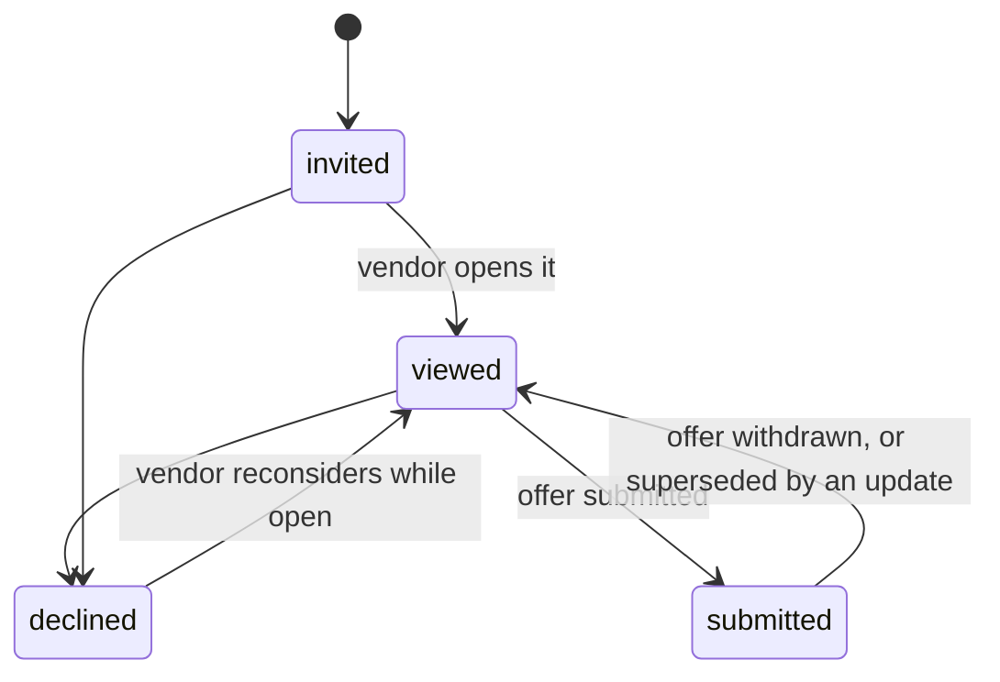

### Offer

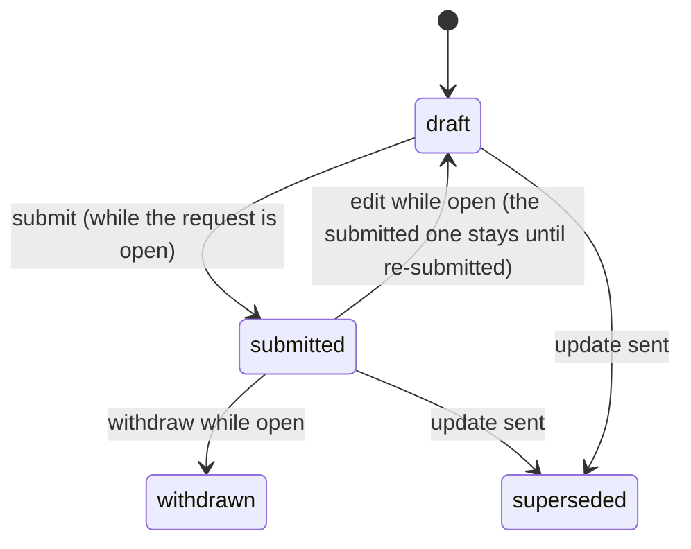

- Submitting needs a rate on every line with a quantity unless the request allows partial
  offers (default on). After an update, a new draft is created with rates carried over by line
  key and unit; the vendor submits again. After close nothing changes (`409 deadline_passed`).

