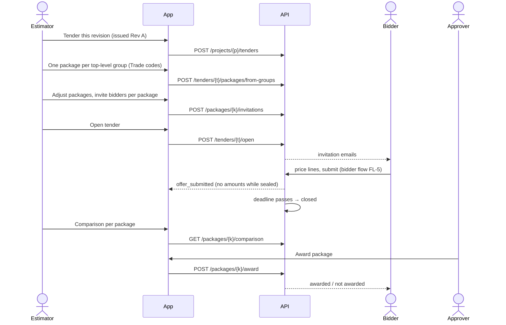

# End-to-end flows

Each flow lists the steps a person takes, the screen, and the API calls. Diagrams show the
system interaction where it isn't obvious. Screens are defined in [screens.md](screens.md).

## FL-1 Onboarding: from sign-up to first project

| # | Actor | Step | Screen | API |
|---|---|---|---|---|
| 1 | Visitor | Sign up through the auth adapter | `/sign-up` | (auth provider) |
| 2 | User | Lands in onboarding, names the org, picks currency / units / country | `/onboarding` | `GET /me`, `POST /orgs` |
| 3 | Owner | Optional: invite colleagues (skip allowed) | `/onboarding` step 2 | `POST /orgs/{id}/invitations` |
| 4 | Owner | Empty dashboard with "Create your first project" and "Try with a sample project" | `/{org}` | `GET /orgs/{id}/projects` |
| 5 | Owner | Sample project: a copy of the Duplex project (model, BoQ, a few answered questions) to explore | `/{org}/projects/{p}` | `POST /orgs/{id}/projects?sample=duplex` |

The sample project doesn't count as an active project, and its processing doesn't count as usage.

## FL-2 Main loop: models to an issued BoQ

```mermaid
sequenceDiagram
  actor E as Estimator
  participant UI as Next.js app
  participant API as API (mock → Java)
  participant S as Object storage
  participant W as Engine worker
  E->>UI: Add model "Architecture", drop IFC
  UI->>API: POST /models/{m}/versions
  API-->>UI: version + presigned upload URL
  UI->>S: PUT file (progress)
  UI->>API: POST /model-versions/{v}/complete
  API->>W: enqueue parse job
  W->>S: read IFC, write parsed.json, geometry.glb, meshes.npz, scene.json
  W-->>API: job succeeded (summary, checks)
  API-->>UI: SSE job.finished, notification
  E->>UI: Create BoQ (defaults), Generate
  UI->>API: POST /projects/{p}/boqs, POST /revisions/{r}/runs
  API->>W: enqueue run job (resolved presets, decisions, adjustments)
  W->>S: write result.json, boq.xlsx
  W-->>API: job succeeded
  API->>API: ingest lines, questions, log; run = needs_input
  API-->>UI: SSE job.finished
  E->>UI: Answer questions (bulk), Regenerate
  UI->>API: POST /projects/{p}/decisions, POST /revisions/{r}/runs
  API-->>UI: run complete
  E->>UI: Review lines, trace, viewer; override one line; add preliminaries
  E->>UI: Regenerate, Submit for review
  UI->>API: POST /revisions/{r}/submit
  actor A as Approver
  A->>UI: Review screen, approve, issue
  UI->>API: POST /revisions/{r}/approve, POST /revisions/{r}/issue
  API->>W: export job (frozen Excel)
```

Steps in words:
1. Models screen → add models → upload versions (F03). The user may leave. A notification
   arrives when the version is ready.
2. Read the input-check report. Fix bad exports in the authoring tool and upload again if
   needed (design firms, P01).
3. BoQs → New BoQ → setup prefilled → Generate (F04).
4. Questions tab → answer (bulk where possible) → Regenerate (F05).
5. Sheet → check lines, trace and viewer, override, add manual lines → Regenerate (F06, F07).
6. Submit → reviewer approves → issue (F09). The frozen Excel is ready to download (F12).

## FL-3 New model version → Rev B

| # | Actor | Step | Screen | API |
|---|---|---|---|---|
| 1 | Estimator | Uploads Architecture v2 (with a note) | model page | F03 calls |
| 2 | System | Marks BoQs using v1 "new version available", notifies | — | `boq.new_version_available` |
| 3 | Estimator | On the issued BoQ: "Start Rev B with v2" | BoQ workspace | `POST /boqs/{b}/revisions` + `PATCH /revisions/{r}` |
| 4 | Estimator | Generate. Only new questions appear. Answer them | Questions | runs, decisions |
| 5 | Estimator | Changes tab: report vs Rev A. Checks the big deltas in the viewer (colour by changes) | Changes | `POST /runs/{run}/compare`, `GET /diffs/{d}/lines` |
| 6 | Estimator | Submit. Approver reads the change report first, approves, issues Rev B | Review | F09 calls |
| 7 | System | If a tender is open on Rev A: the issue dialog offers "Create addendum" | Issue dialog | `POST /tenders/{t}/addenda` |

## FL-4 Tender: firm side



## FL-5 Tender: bidder side

| # | Step | Screen | API |
|---|---|---|---|
| 1 | Opens the invitation email link | `/bid-invite/{token}` | `GET /bid-tokens/{token}` |
| 2 | Signs in or signs up (name, company) | auth adapter | `POST /bid-tokens/{token}/accept` |
| 3 | Sees all their invitations across firms | `/bids` | `GET /bids` |
| 4 | Opens a package: instructions, attachments, lines | `/bids/{i}` | `GET /bids/{i}`, `GET /bids/{i}/lines` |
| 5a | Enters rates in the browser (autosave) | `/bids/{i}` | `PUT /bids/{i}/offer` |
| 5b | Or downloads Excel, fills it in offline, uploads it, reviews the import report | `/bids/{i}` | `GET /bids/{i}/package.xlsx`, `POST /bids/{i}/offer/import` |
| 6 | Adds notes and qualifications, submits | `/bids/{i}` | `POST /bids/{i}/offer/submit` |
| 7 | Addendum arrives: reviews highlighted changes, resubmits | `/bids/{i}` | same |
| 8 | After the award: sees the outcome | `/bids` | `GET /bids` |

## FL-6 Library: encode the office standard

| # | Actor | Step | Screen | API |
|---|---|---|---|---|
| 1 | Library editor | Library → Rule sets → New → "Patch on As modelled" | `/{org}/library/rule_set/new` | `POST /orgs/{o}/presets` |
| 2 | | Settings tab: answers the questions their rulebook answers | editor | `PUT /presets/{id}/draft` (autosave, check) |
| 3 | | Preview on a project model: sees the lines change next to the editor | editor preview panel | `POST /presets/{id}/preview`, job, SSE |
| 4 | | BoQ items: adds a company item, edits a formula (readable form) | editor | autosave |
| 5 | | Publish v1 with a note | editor | `POST /presets/{id}/publish` |
| 6 | | Classifications → New → import the office code list from Excel → map items | classification editor | `POST /codelists/read`, `/build` |
| 7 | | Sets them as project defaults on new projects (org setting "starred presets") | Library | `PATCH /presets/{id}` (`starred`) |

## FL-7 Questions, the fast path

Unknown names are the most common blocker on real files (docs/11). The flow must be fast:
1. Questions tab, filter "Names", sorted by occurrences.
2. Multi-select rows with the same meaning → pick a term once (search with hierarchy,
   e.g. "concrete › in situ") → Apply. "Also add to project dictionary" is on by default.
3. Library editors see "Promote to company dictionary" on applied name answers.
4. Regenerate (one click, header).

## FL-8 Plans and limits

1. Free org hits `activeProjects` creating a second project → `402` → limit dialog.
2. Owner → "Upgrade" → plan cards → `POST /orgs/{o}/billing/checkout` → provider checkout →
   return URL → webhook updates the subscription → entitlements refresh → retry works.
