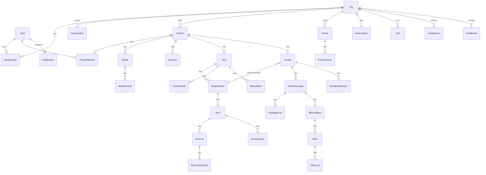

# Data model

The platform's entities, fields and relations. This is the source for `05-api/openapi.yaml`
(resource shapes) and `07-backend/db-schema.md` (tables). Engine shapes (`BoqLine`,
`Question`, `RuleSet`, `Dictionary`, `CodeList`, `ClassificationMap`, `ModelScope`,
`Decision`, `BoqResult`...) are **not redefined here**. They come from `packages/types/src`
and their JSON Schemas in `packages/types/schema`.

Conventions:
- Every id is a UUID string (UUIDv7 recommended so ids sort by creation time).
- Every entity has `createdAt` (and, where mutable, `updatedAt`), ISO 8601 UTC.
- `createdBy` / `updatedBy` are user ids where a person acted.
- Everything below `Org` carries `orgId`, directly or through its parent, and every query is
  filtered by it (tenant isolation, see `04-architecture/security.md`).

## Overview



## Identity and tenancy

### User
| Field | Type | Notes |
|---|---|---|
| id | uuid | |
| email | string | unique, lower-cased |
| name | string | |
| locale | string | BCP 47, default `en` |
| authSubject | string | id at the auth provider (P10); unique |
| createdAt | datetime | |

A user can be a member of several orgs, a guest in other orgs' projects and a bidder for any
number of tenders, all with one login.

### Org
| Field | Type | Notes |
|---|---|---|
| id | uuid | |
| name | string | |
| slug | string | unique, URL-safe, used in frontend routes |
| settings.fourEyes | boolean | the submitter of a revision cannot approve it (plan feature) |
| settings.defaultLocale | string | |
| settings.defaultCurrency | string | ISO 4217 |
| settings.defaultUnitSystem | `metric` \| `imperial` | |
| createdAt | datetime | |

### Membership
| Field | Type | Notes |
|---|---|---|
| orgId, userId | uuid | unique pair |
| role | `owner` \| `admin` \| `library_editor` \| `member` | see permissions |
| createdAt | datetime | |

### OrgInvitation
| Field | Type | Notes |
|---|---|---|
| id | uuid | |
| orgId | uuid | |
| email | string | |
| role | org role | |
| token | string | random, single use; only the hash is stored |
| status | `pending` \| `accepted` \| `revoked` \| `expired` | |
| expiresAt | datetime | default 14 days |
| invitedBy | uuid | |

### Subscription
| Field | Type | Notes |
|---|---|---|
| orgId | uuid | one per org |
| planId | string | `free`, `professional`, `team`, `enterprise` |
| status | `active` \| `trialing` \| `past_due` \| `cancelled` | |
| trialEndsAt, currentPeriodEnd | datetime? | |
| provider | string? | e.g. `paddle`; null on free |
| providerCustomerId, providerSubscriptionId | string? | |
| overrides | Entitlements? | per-org exceptions (enterprise) |

### Plan (configuration, not user data)
`{id, name, entitlements: Entitlements, public: boolean}`. `Entitlements` fields are listed in
`00-product/05-plans-and-limits.md`.

## Projects and models

### Project
| Field | Type | Notes |
|---|---|---|
| id | uuid | |
| orgId | uuid | |
| name | string | |
| code | string? | the firm's job number |
| client | string? | free text |
| location | `{address?, country?}` | ISO 3166 country |
| currency | string | ISO 4217, default from org |
| unitSystem | `metric` \| `imperial` | |
| locale | string | used for exports |
| status | `active` \| `archived` | |
| sample | boolean | the onboarding sample project (FL-1); counts towards no limit |
| defaults | `{ruleSetVersionId?, classificationVersionIds[], dictionaryVersionIds[], federationVersionId?}` | preselected for new BoQs |
| projectDictionaryId | uuid | the project-layer dictionary preset, created with the project |

### ProjectMember
| Field | Type | Notes |
|---|---|---|
| projectId, userId | uuid | unique pair |
| role | `lead` \| `estimator` \| `approver` \| `viewer` \| `guest` | |
| addedBy | uuid | |

Org owners and admins have `lead` rights on every project without a row.

### Model
| Field | Type | Notes |
|---|---|---|
| id | uuid | |
| projectId | uuid | |
| name | string | "Architecture", "Structure – Block B" |
| discipline | string | `architecture`, `structure`, `mep`, or another key of the federation settings |
| scope | engine `ModelScope` | include / exclude selectors |
| latestVersionId | uuid? | latest `ready` version |
| archived | boolean | |

### ModelVersion
| Field | Type | Notes |
|---|---|---|
| id | uuid | |
| modelId | uuid | |
| number | int | 1, 2, 3 per model |
| fileName | string | |
| sizeBytes | int | |
| sha256 | string | content hash; identical uploads reuse the parse |
| storageKey | string | raw IFC in object storage |
| status | see state machines | `awaiting_upload` → `queued` → `processing` → `ready` \| `failed` |
| parseJobId | uuid? | |
| summary | engine `ModelSummary` (minus `modelId`, `cached`) | schema, authoring app, storeys, counts, byClass, checks, parseMs |
| artifacts | `{parsedKey, geometryKey, meshesKey, sceneKey}` | storage keys written by the parse job |
| error | `{code, message}`? | when failed |
| note | string? | the uploader's comment ("after facade change") |
| uploadedBy, uploadedAt | | |

## Library

### Preset
| Field | Type | Notes |
|---|---|---|
| id | uuid | |
| orgId | uuid? | null for system presets |
| projectId | uuid? | set for project-layer presets |
| layer | `system` \| `org` \| `project` | |
| kind | `rule_set` \| `classification` \| `dictionary` \| `federation` \| `resolution` | |
| slug | string | unique per org + kind; the engine document's `id` |
| name, description | string | |
| basedOn | string? | free text ("our reading of NRM2"), see D32 |
| starred | boolean | org favourites; starred presets prefill new projects' defaults |
| latestPublishedVersionId | uuid? | |
| draftVersionId | uuid? | at most one draft |
| archived | boolean | archived presets can't be picked for new BoQs; old runs keep their snapshots |

### PresetVersion
| Field | Type | Notes |
|---|---|---|
| id | uuid | |
| presetId | uuid | |
| number | int | 1, 2, 3; drafts have `number = null` until published |
| status | `draft` \| `published` | published versions are immutable |
| doc | JSON | the engine document: `RuleSet`/`RuleSetPatch`, `{codeList, map}` for classifications, `Dictionary`, `FederationSettings`, `ResolutionSettings` |
| extendsVersionId | uuid? | rule-set patches: the exact parent version |
| problems | string[] | last engine check result (empty = valid) |
| changeNote | string? | written on publish |
| publishedBy, publishedAt | | |

A classification version's `doc` is `{codeList: CodeList, map: ClassificationMap}`. Large code
lists (Uniclass) may be stored in object storage, with `doc.codeList` replaced by a storage key.

## Decisions and adjustments

### Decision
| Field | Type | Notes |
|---|---|---|
| id | uuid | |
| projectId | uuid | |
| questionId | string | engine question id (deterministic, D19); unique per project |
| kind | engine `QuestionKind` | copied for filtering |
| answer | string \| number \| boolean \| null | null = dismissed ("leave it") |
| note | string? | |
| decidedBy, decidedAt | | |
| promotedToPresetVersionId | uuid? | set when promoted to the company dictionary |

Sent to the engine as engine `Decision {questionId, scope: "project", answer, note, decidedBy, decidedAt}`.
History: a changed answer keeps the old row with `supersededAt` (audit), the API returns
current rows only.

### LineOverride (per BoQ, carried to later revisions)
| Field | Type | Notes |
|---|---|---|
| id | uuid | |
| boqId | uuid | |
| lineKey | string | unique per BoQ |
| quantity | number \| null | null = force flagged |
| reason | string | required |
| createdBy, createdAt | | |

Sent to the engine as a decision with `questionId = "override:{lineKey}"` (engine task EN-003).
The engine applies it, logs it, marks the line, and raises an `orphan_override` question if the
line no longer exists.

### ManualItem (per BoQ)
A manual line added in the sheet: an engine `ManualItem` rule (id, description, unit,
quantity or formula over `building.*`, codes) plus `{id, boqId, sortHint?, createdBy}`. Sent to
the engine as a project-level patch that appends manual items to the rule set at run time.

## BoQs, revisions, runs

### Boq
| Field | Type | Notes |
|---|---|---|
| id | uuid | |
| projectId | uuid | |
| name | string | "Tender BoQ", "Cost check stage 3" |
| description | string? | |
| currentRevisionId | uuid | the newest revision, whatever its status |
| latestIssuedRevisionId | uuid? | |
| archived | boolean | |

### BoqRevision
| Field | Type | Notes |
|---|---|---|
| id | uuid | |
| boqId | uuid | |
| number | int | 1, 2, 3 |
| label | string | "A", "B", "C" (from number; configurable later) |
| status | `draft` \| `in_review` \| `approved` \| `issued` | see state machines |
| inputs | `RevisionInputs` | below; editable only in `draft` |
| currentRunId | uuid? | the run shown in the sheet |
| basedOnRevisionId | uuid? | the issued revision this one continues |
| submittedBy/At, approvedBy/At, issuedBy/At | | |
| reviewers | uuid[] | chosen at submit |
| reviewComments | `{id, by, at, text, lineKey?, outcome?: "approved" \| "changes_requested"}[]` | `lineKey` for comments on one line |
| pendingChanges | string[] | computed: what differs from the current run's request (`inputs.models`, `inputs.ruleSet`, `decisions`, `adjustments`...) |
| frozen | `{runId, adjustments, exportIds[]}`? | written at issue; immutable |

`RevisionInputs`:
```json
{
  "models": [ { "modelId": "…", "modelVersionId": "…", "discipline": "architecture", "scope": { "exclude": [] } } ],
  "ruleSetVersionId": "…",
  "classificationVersionIds": ["…"],
  "dictionaryVersionIds": ["…"],
  "federationVersionId": "…",
  "resolutionVersionId": "…"
}
```
Model scope and discipline are copied from the `Model` when the revision is created and can be
changed per revision. The project dictionary is always added as the most specific dictionary
layer.

### Run (immutable)
| Field | Type | Notes |
|---|---|---|
| id | uuid | |
| revisionId | uuid | |
| jobId | uuid | |
| status | `queued` \| `running` \| `complete` \| `needs_input` \| `failed` \| `cancelled` | |
| request | `RunJobInput` | the resolved request sent to the engine (inputs + snapshot + decisions + adjustments) |
| snapshot | `{ruleSet, classifications[], dictionaries[], federation, resolution}` | flattened docs with their version ids |
| resultKey | string? | full `BoqResult` JSON in storage |
| xlsxKey | string? | Excel written with the run |
| stats | engine `BoqResult.stats` + `{blockingQuestions, questions, warnings}` | |
| building | engine `BuildingMeasures`? | |
| models | engine `ModelReport[]` | |
| createdBy, createdAt, finishedAt | | |

### RunLine, RunLineElement, RunQuestion, RunLogEntry, RunWarning
Rows written from the `BoqResult` when a run job succeeds, so lines can be paged, filtered and
grouped without loading the whole result.

- `RunLine`: `{runId, lineKey, sortIndex, ruleId, ruleKind, description, unit, quantity, source, family, keys, codes, location, tags, notes, trace, overridden: {quantity, reason}?}`. Same fields as engine `BoqLine` plus `sortIndex` and `overridden`.
- `RunLineElement`: `{runId, lineKey, guid, modelVersionId, quantity}`. The element ↔ line index for the viewer and for diffs.
- `RunQuestion`: engine `Question` + `{runId}`. Whether it is answered is a join with `Decision`.
- `RunLogEntry`: engine `LogEntry` + `{runId}`.
- `RunWarning`: engine `Warning` + `{runId}`.

### RunDiff (computed, cached)
`{fromRunId, toRunId, jobId, summary, lines: LineChange[], elements: ElementChange[], questions: {new[], resolved[]}}`.
- `LineChange`: `{lineKey, change: "added" | "removed" | "changed", before?: {quantity, unit, description, codes}, after?: {…}, delta?: number, deltaPct?: number, causes: ("elements_added" | "elements_removed" | "elements_changed" | "rules_changed" | "decision_changed" | "override_changed")[]}`
- `ElementChange`: `{guid, model, change: "added" | "removed" | "changed", fields?: string[]}`

## Tendering

### Tender
| Field | Type | Notes |
|---|---|---|
| id | uuid | |
| projectId | uuid | |
| revisionId | uuid | an **issued** revision (latest addendum's revision) |
| name | string | |
| currency | string | ISO 4217, default project currency |
| deadline | datetime | with timezone |
| instructions | string | shown to bidders (markdown) |
| timezone | string | IANA zone the deadline is expressed in |
| attachments | `TenderAttachment[]` | `{id, fileName, storageKey, sizeBytes, uploadedBy, uploadedAt}`: drawings, specs (PDF etc.) |
| sealed | boolean | default true |
| allowPartial | boolean | default false; offers may leave lines unpriced |
| deviationThresholdPct | number | default 30; comparison flags rates further than this from the median |
| sharedWithGuests | boolean | default false; project guests may see the comparison after close |
| status | `draft` \| `open` \| `closed` \| `awarded` \| `cancelled` | |
| openedAt, closedAt | | |

### TenderAddendum
`{id, tenderId, number, revisionId, note, createdBy, createdAt, affectedPackageIds[]}`. Number 0
is the opening state. Every addendum re-snapshots the package lines.

### TenderPackage
| Field | Type | Notes |
|---|---|---|
| id | uuid | |
| tenderId | uuid | |
| name | string | "Concrete works" |
| code | string? | |
| selection | `PackageSelection` | how its lines were chosen (re-applied at addenda) |
| status | `open` \| `awarded` \| `cancelled` | |
| awardedOfferId | uuid? | |

`PackageSelection`: `{byCode?: {system, codes[]}[], byFamily?: string[], lineKeys?: string[], excludeLineKeys?: string[]}`.
A line belongs to at most one package of a tender. The API rejects overlapping selections with
`409 line_in_other_package`.

### PackageLine (frozen copy, per addendum)
`{id, packageId, addendumNumber, lineKey, sortIndex, code, description, unit, quantity, source, notes}`.
Flagged lines (quantity null) are included and shown as "quantity to be confirmed". Bidders may
price them as a rate only.

### BidInvitation
| Field | Type | Notes |
|---|---|---|
| id | uuid | |
| packageId | uuid | |
| email | string | |
| companyName | string | |
| contactName | string? | |
| userId | uuid? | set when the bidder accepts with an account |
| token | string | hash stored; link in the invitation email |
| status | `invited` \| `viewed` \| `declined` \| `submitted` | `submitted` while a current offer exists |
| declineReason | string? | |

### Offer
| Field | Type | Notes |
|---|---|---|
| id | uuid | |
| invitationId | uuid | |
| addendumNumber | int | which package-line snapshot it prices |
| status | `draft` \| `submitted` \| `withdrawn` \| `superseded` | |
| total | decimal | sum of line amounts, computed by the backend |
| notes, qualifications | string | |
| validUntil | date? | |
| source | `portal` \| `excel` | |
| submittedAt | datetime? | |

### OfferLine
`{offerId, packageLineId, lineKey, rate: decimal | null, amount: decimal | null, note?}`.
`amount = round(quantity × rate, currency minor units)`; null when the rate or quantity is null.

### Bidder address book (derived)
`GET /orgs/{orgId}/bidders` lists distinct `{email, companyName, contactName, lastInvitedAt, tenders}`
from the org's past invitations. No separate entity in v1.

## Exports

### Export
`{id, orgId, projectId, kind: "boq_xlsx" | "issued_boq_xlsx" | "changes_xlsx" | "package_xlsx" | "comparison_xlsx", subjectType, subjectId, fileName, storageKey, sizeBytes, jobId, createdBy, createdAt}`.
Issued exports are referenced from `BoqRevision.frozen.exportIds` and never deleted while the
revision exists.

## Jobs, notifications, usage, audit

### Job
| Field | Type | Notes |
|---|---|---|
| id | uuid | |
| orgId, projectId | uuid | |
| type | `parse` \| `run` \| `preview` \| `diff` \| `export_xlsx` \| `export_package` \| `export_comparison` \| `import_offer` \| `names` | |
| status | `queued` \| `running` \| `succeeded` \| `failed` \| `cancelled` | |
| progress | `{stage: string, pct: number, message?: string}` | |
| input | JSON | per type, see `04-architecture/engine-worker.md` |
| output | JSON? | per type |
| error | `{code, message, retryable}`? | |
| attempts | int | |
| subjectType, subjectId | | the entity the job is for (model version, run, preset version...) |
| createdBy, createdAt, startedAt, finishedAt | | |

### Notification
`{id, userId, orgId?, kind, title params, entityType, entityId, url, readAt?, createdAt}`.
Kinds: see F13.

### UsageEvent
`{id, orgId, projectId?, jobId, kind: "parse" | "run" | "preview", durationMs, modelBytes, elementCount, outcome, at}`.

### AuditEvent (append-only)
`{id, orgId, projectId?, actorId, actorKind: "user" | "system" | "bidder", action, entityType, entityId, data, ip?, at}`.
Actions are dotted verbs: `model_version.uploaded`, `decision.set`, `revision.issued`,
`tender.opened`, `offer.submitted`, `package.awarded`, `member.role_changed`... (full list in F09).
