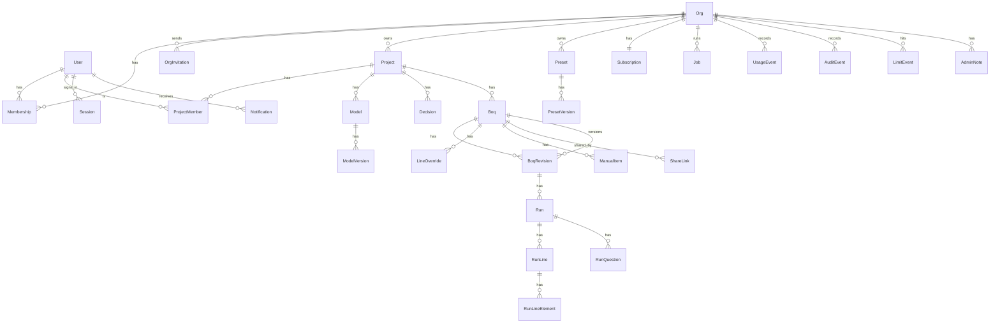

# Data model

The platform's entities, fields and relations. This is the source for `05-api/openapi.yaml`
(resource shapes) and `07-backend/db-schema.md` (tables). Engine shapes (`BoqLine`,
`Question`, `RuleSet`, `Dictionary`, `CodeList`, `ClassificationMap`, `ModelScope`,
`Decision`, `BoqResult`...) are **not redefined here**. They come from `packages/types/src`
and their JSON Schemas in `packages/types/schema`.

Conventions:
- Every id is a UUID string (UUIDv7 recommended so ids sort by creation time).
- Every entity has `createdAt` (and, where mutable, `updatedAt`), ISO 8601 UTC.
- `createdBy` / `updatedBy` are user ids where a person acted.
- Everything below `Org` carries `orgId`, directly or through its parent, and every query is
  filtered by it (tenant isolation, see `04-architecture/security.md`).

## Overview



The pricing module's entities (vendors, pricebooks, estimates, offer requests) are not part of
the core model. They live in the module's own schema and reference core entities one way only
(last section, P36, `04-architecture/modules.md`).

## Identity and tenancy

### User
| Field | Type | Notes |
|---|---|---|
| id | uuid | |
| email | string | unique, lower-cased |
| name | string | |
| locale | string | BCP 47, default `en` |
| authSubject | string | id at the auth provider (P10); unique |
| platformRole | `admin`? | operator of the product (F19); set by CLI/seed only |
| createdAt | datetime | |

A user can be a member of several orgs, and (with the pricing module) a vendor linked to any
number of orgs, all with one login and one active session (BR-54). There are no logged-in
guests (P28): outsiders get share links (F18).

### Session
| Field | Type | Notes |
|---|---|---|
| id | uuid | carried by every request (cookie or token claim `sid`) |
| userId | uuid | at most one `active` per user (BR-54) |
| status | `active` \| `ended` \| `replaced` \| `expired` | |
| deviceLabel | string | "Chrome on Windows", from the user agent |
| place | string? | approximate, from the IP (country, city), for the takeover question |
| lastSeenAt | datetime | updated at most once a minute; idle > 12 h → `expired` |
| replacedBySessionId | uuid? | |
| createdAt, endedAt | datetime | |

### Org
| Field | Type | Notes |
|---|---|---|
| id | uuid | |
| name | string | |
| slug | string | unique, URL-safe, used in frontend routes |
| settings.fourEyes | boolean | the submitter of a revision cannot approve it (plan feature) |
| settings.defaultLocale | string | |
| settings.defaultCurrency | string | ISO 4217 |
| settings.defaultUnitSystem | `metric` \| `imperial` | |
| settings.approvalRequired | boolean | default false; saving a version needs review and approval (F09 §4, P29) |
| settings.numberFormat | `{decimal: "." \| ",", thousands: "," \| "." \| " " \| "'" \| ""}`? | overrides the locale's defaults (P35) |
| settings.dateFormat | string? | e.g. `dd.MM.yyyy`; overrides the locale's default |
| settings.defaultLanguage | string | UI language for new members, default `en` |
| settings.publicLinksAllowed | boolean | default true (F18) |
| status | `active` \| `suspended` \| `deleting` | suspended by a platform admin (F19): read-only, no new jobs |
| tags | string[] | platform admin's sales tags (F19); never shown to the org |
| setup | `OrgSetup`? | setup wizard progress (F16): `{status: "in_progress" \| "done", step, modelVersionId?, ruleSetPresetId?, classificationPresetId?, dictionaryPresetId?, startedBy, updatedAt, completedAt?}` |
| createdAt | datetime | |

### Membership
| Field | Type | Notes |
|---|---|---|
| orgId, userId | uuid | unique pair |
| role | `owner` \| `admin` \| `library_editor` \| `member` | see permissions |
| createdAt | datetime | |

### OrgInvitation
| Field | Type | Notes |
|---|---|---|
| id | uuid | |
| orgId | uuid | |
| email | string | |
| role | org role | |
| token | string | random, single use; only the hash is stored |
| status | `pending` \| `accepted` \| `revoked` \| `expired` | |
| expiresAt | datetime | default 14 days |
| invitedBy | uuid | |

### Subscription
| Field | Type | Notes |
|---|---|---|
| orgId | uuid | one per org |
| planId | string | `free`, `professional`, `team`, `enterprise` |
| status | `active` \| `trialing` \| `past_due` \| `cancelled` | |
| trialEndsAt, currentPeriodEnd | datetime? | |
| provider | string? | e.g. `paddle`; null on free |
| providerCustomerId, providerSubscriptionId | string? | |
| overrides | Entitlements? | per-org exceptions (enterprise) |

### Plan (configuration, not user data)
`{id, name, entitlements: Entitlements, public: boolean}`. `Entitlements` fields are listed in
`00-product/05-plans-and-limits.md`.

## Projects and models

### Project
| Field | Type | Notes |
|---|---|---|
| id | uuid | |
| orgId | uuid | |
| name | string | |
| code | string? | the firm's job number |
| client | string? | free text |
| location | `{address?, country?}` | ISO 3166 country |
| currency | string | ISO 4217, default from org |
| unitSystem | `metric` \| `imperial` | |
| locale | string | used for exports |
| status | `active` \| `archived` | |
| sample | boolean | the onboarding sample project (FL-1); counts towards no limit |
| defaults | `{ruleSetVersionId?, classificationVersionIds[], dictionaryVersionIds[], federationVersionId?}` | preselected for new BoQs |
| projectDictionaryId | uuid | the project-layer dictionary preset, created with the project |

### ProjectMember
| Field | Type | Notes |
|---|---|---|
| projectId, userId | uuid | unique pair |
| role | `lead` \| `estimator` \| `approver` \| `viewer` | org members only (P28) |
| addedBy | uuid | |

Org owners and admins have `lead` rights on every project without a row.

### Model
| Field | Type | Notes |
|---|---|---|
| id | uuid | |
| projectId | uuid | |
| name | string | "Architecture", "Structure – Block B" |
| discipline | string | `architecture`, `structure`, `mep`, or another key of the federation settings |
| scope | engine `ModelScope` | include / exclude selectors |
| latestVersionId | uuid? | latest `ready` version |
| archived | boolean | |

### ModelVersion
| Field | Type | Notes |
|---|---|---|
| id | uuid | |
| modelId | uuid | |
| number | int | 1, 2, 3 per model |
| fileName | string | |
| sizeBytes | int | |
| sha256 | string | content hash; identical uploads reuse the parse |
| storageKey | string | raw IFC in object storage |
| status | see state machines | `awaiting_upload` → `queued` → `processing` → `ready` \| `failed` |
| parseJobId | uuid? | |
| summary | engine `ModelSummary` (minus `modelId`, `cached`) | schema, authoring app, storeys, counts, byClass, checks, parseMs |
| artifacts | `{parsedKey, geometryKey, meshesKey, sceneKey}` | storage keys written by the parse job |
| error | `{code, message}`? | when failed |
| note | string? | the uploader's comment ("after facade change") |
| uploadedBy, uploadedAt | | |

## Library

### Preset
| Field | Type | Notes |
|---|---|---|
| id | uuid | |
| orgId | uuid? | null for system presets |
| projectId | uuid? | set for project-layer presets |
| layer | `system` \| `org` \| `project` | |
| kind | `rule_set` \| `classification` \| `dictionary` \| `federation` \| `resolution` | |
| slug | string | unique per org + kind; the engine document's `id` |
| name, description | string | |
| basedOn | string? | free text ("our reading of NRM2"), see D32 |
| starred | boolean | org favourites; starred presets prefill new projects' defaults |
| latestPublishedVersionId | uuid? | |
| draftVersionId | uuid? | at most one draft |
| archived | boolean | archived presets can't be picked for new BoQs; old runs keep their snapshots |

### PresetVersion
| Field | Type | Notes |
|---|---|---|
| id | uuid | |
| presetId | uuid | |
| number | int | 1, 2, 3; drafts have `number = null` until published |
| status | `draft` \| `published` | published versions are immutable |
| doc | JSON | the engine document: `RuleSet`/`RuleSetPatch`, `{codeList, map}` for classifications, `Dictionary`, `FederationSettings`, `ResolutionSettings` |
| extendsVersionId | uuid? | rule-set patches: the exact parent version |
| problems | string[] | last engine check result (empty = valid) |
| changeNote | string? | written on publish |
| publishedBy, publishedAt | | |

A classification version's `doc` is `{codeList: CodeList, map: ClassificationMap}`. Large code
lists (Uniclass) may be stored in object storage, with `doc.codeList` replaced by a storage key.
A code's `description` is its **item text** (P14): a template with blanks, filled per line by
the engine into `LineCode.text` (EN-010).

## Decisions and adjustments

### Decision
| Field | Type | Notes |
|---|---|---|
| id | uuid | |
| projectId | uuid | |
| questionId | string | engine question id (deterministic, D19); unique per project |
| kind | engine `QuestionKind` | copied for filtering |
| answer | string \| number \| boolean \| null | null = dismissed ("leave it") |
| note | string? | |
| decidedBy, decidedAt | | |
| promotedToPresetVersionId | uuid? | set when promoted to the company dictionary |

Sent to the engine as engine `Decision {questionId, scope: "project", answer, note, decidedBy, decidedAt}`.
History: a changed answer keeps the old row with `supersededAt` (audit), the API returns
current rows only.

### LineOverride: a line edit (per BoQ, carried to later revisions)
| Field | Type | Notes |
|---|---|---|
| id | uuid | |
| boqId | uuid | |
| lineKey | string | unique per BoQ; all edits of one line live in one row |
| quantity | number \| null? | absent = not edited; null = force flagged |
| description | string? | replaces the shown text (item text or line text) |
| unit | string? | only together with `quantity` (`409 unit_needs_quantity`) |
| codes | `Record<system, code>`? | moves the line to another section in that classification |
| sortAfter | string \| null? | line key it follows inside its section; null = first; presentation only |
| excluded | boolean? | out of totals and the exports' BoQ sheet, still listed (BR-03) |
| reason | string? | required when `quantity` or `excluded` is set |
| createdBy, createdAt | | |

Sent to the engine as a decision with `questionId = "override:{lineKey}"` and the edited fields
(engine task EN-003): quantity before derived rules (derived lines follow it), codes as the
line's classification decision, description, unit and exclusion on the final line. `sortAfter`
is applied by the backend when ordering lines (no number involved).
The engine applies it, logs it, marks the line, and raises an `orphan_override` question if the
line no longer exists.

### ManualItem (per BoQ)
A manual line added in the sheet: an engine `ManualItem` rule (id, description, unit,
quantity or formula over `building.*`, codes) plus `{id, boqId, sortHint?, createdBy}`. Sent to
the engine as a project-level patch that appends manual items to the rule set at run time.

## BoQs, revisions, runs

### Boq
| Field | Type | Notes |
|---|---|---|
| id | uuid | |
| projectId | uuid | |
| name | string | "Tender BoQ", "Cost check stage 3" |
| description | string? | |
| status | `working` \| `confirmed` | P29; confirmed = done, read-only until reopened (F09 §5–6) |
| confirmedBy, confirmedAt | | |
| currentRevisionId | uuid | the working version (a `draft` revision), or the last saved one when confirmed |
| latestIssuedRevisionId | uuid? | the last saved version |
| archived | boolean | |

### BoqRevision
| Field | Type | Notes |
|---|---|---|
| id | uuid | |
| boqId | uuid | |
| number | int | 1, 2, 3 |
| label | string | "A", "B", "C" (from number; configurable later) |
| status | `draft` \| `in_review` \| `approved` \| `issued` | shown as Working / In review / Approved / Saved; review states only when `approvalRequired` (P29) |
| inputs | `RevisionInputs` | below; editable only in `draft` |
| currentRunId | uuid? | the run shown in the sheet |
| basedOnRevisionId | uuid? | the saved version this working version continues |
| submittedBy/At, approvedBy/At, issuedBy/At | | |
| reviewers | uuid[] | chosen at submit |
| reviewComments | `{id, by, at, text, lineKey?, outcome?: "approved" \| "changes_requested"}[]` | `lineKey` for comments on one line |
| pendingChanges | string[] | computed: what differs from the current run's request (`inputs.models`, `inputs.ruleSet`, `decisions`, `adjustments`...) |
| frozen | `{runId, adjustments, positionNumbers, exportIds[]}`? | written when the version is saved; immutable |
| saveNote | string? | the note given when saving |
| openQuestionsAtSave | int? | blocking questions open when saved (allowed, shown as a badge) |

`RevisionInputs`:
```json
{
  "models": [ { "modelId": "…", "modelVersionId": "…", "discipline": "architecture", "scope": { "exclude": [] } } ],
  "ruleSetVersionId": "…",
  "classificationVersionIds": ["…"],
  "dictionaryVersionIds": ["…"],
  "federationVersionId": "…",
  "resolutionVersionId": "…"
}
```
Model scope and discipline are copied from the `Model` when the revision is created and can be
changed per revision. The project dictionary is always added as the most specific dictionary
layer.

### Run (immutable)
| Field | Type | Notes |
|---|---|---|
| id | uuid | |
| revisionId | uuid | |
| jobId | uuid | |
| status | `queued` \| `running` \| `complete` \| `needs_input` \| `failed` \| `cancelled` | |
| request | `RunJobInput` | the resolved request sent to the engine (inputs + snapshot + decisions + adjustments) |
| snapshot | `{ruleSet, classifications[], dictionaries[], federation, resolution}` | flattened docs with their version ids |
| resultKey | string? | full `BoqResult` JSON in storage |
| xlsxKey | string? | Excel written with the run |
| stats | engine `BoqResult.stats` + `{blockingQuestions, questions, warnings}` | |
| building | engine `BuildingMeasures`? | |
| models | engine `ModelReport[]` | |
| createdBy, createdAt, finishedAt | | |

### RunLine, RunLineElement, RunQuestion, RunLogEntry, RunWarning
Rows written from the `BoqResult` when a run job succeeds, so lines can be paged, filtered and
grouped without loading the whole result.

- `RunLine`: `{runId, lineKey, sortIndex, ruleId, ruleKind, description, unit, quantity, source, family, keys, codes, location, tags, notes, trace, overridden: {quantity, reason}?}`. Same fields as engine `BoqLine` plus `sortIndex`, `positionNo` (P30: section code + running number,
  computed by the backend from the line order and edits; frozen in saved versions) and `overridden`. `description` is the rule set's line text; each `codes[system].text` is that system's filled item text, when its code has one (EN-010).
- `RunLineElement`: `{runId, lineKey, guid, modelVersionId, quantity}`. The element ↔ line index for the viewer and for diffs.
- `RunQuestion`: engine `Question` + `{runId}`. Whether it is answered is a join with `Decision`.
- `RunLogEntry`: engine `LogEntry` + `{runId}`.
- `RunWarning`: engine `Warning` + `{runId}`.

### RunDiff (computed, cached)
`{fromRunId, toRunId, jobId, summary, lines: LineChange[], elements: ElementChange[], questions: {new[], resolved[]}}`.
- `LineChange`: `{lineKey, change: "added" | "removed" | "changed", before?: {quantity, unit, description, codes}, after?: {…}, delta?: number, deltaPct?: number, causes: ("elements_added" | "elements_removed" | "elements_changed" | "rules_changed" | "decision_changed" | "override_changed")[]}`
- `ElementChange`: `{guid, model, change: "added" | "removed" | "changed", fields?: string[]}`

## Sharing

### ShareLink (F18)
| Field | Type | Notes |
|---|---|---|
| id | uuid | |
| boqId | uuid | |
| mode | `pinned` \| `latest_issued` | |
| runId | uuid? | for `pinned` |
| include | `{lineDetail, viewer, log, excel}` booleans; `groupBy` classification id | |
| label | string? | |
| tokenHash | string | 32 random bytes, base64url; only the hash is stored |
| expiresAt | datetime? | |
| revokedAt, revokedBy | | |
| views, lastViewedAt | int, datetime? | |
| createdBy, createdAt | | |

## Exports

### Export
`{id, orgId, projectId, kind: "boq_xlsx" | "issued_boq_xlsx" | "changes_xlsx" | string (module kinds, e.g. "pricing.estimate_xlsx"), subjectType, subjectId, fileName, storageKey, sizeBytes, jobId, createdBy, createdAt}`.
Issued exports are referenced from `BoqRevision.frozen.exportIds` and never deleted while the
revision exists.

## Jobs, notifications, usage, audit

### Job
| Field | Type | Notes |
|---|---|---|
| id | uuid | |
| orgId, projectId | uuid | |
| type | `parse` \| `run` \| `preview` \| `diff` \| `export_xlsx` \| `import_boq_edits` \| `names` \| `pricing.*` (module job types) | |
| status | `queued` \| `running` \| `succeeded` \| `failed` \| `cancelled` | |
| progress | `{stage: string, pct: number, message?: string}` | |
| input | JSON | per type, see `04-architecture/engine-worker.md` |
| output | JSON? | per type |
| error | `{code, message, retryable}`? | |
| attempts | int | |
| subjectType, subjectId | | the entity the job is for (model version, run, preset version...) |
| createdBy, createdAt, startedAt, finishedAt | | |

### Notification
`{id, userId, orgId?, kind, title params, entityType, entityId, url, readAt?, createdAt}`.
Kinds: see F13.

### LimitEvent
`{id, orgId, userId?, limit, current, max, action, at}`. Written for every `402`. Feeds the admin
console's "hit a limit" signal (F19).

### AdminNote
`{id, orgId, authorId, text, createdAt}`. Platform admins only (F19); never shown to the org.

### UsageEvent
`{id, orgId, projectId?, jobId, kind: "parse" | "run" | "preview", durationMs, modelBytes, elementCount, outcome, at}`.

### AuditEvent (append-only)
`{id, orgId, projectId?, actorId, actorKind: "user" | "system" | "vendor" | "platform_admin", action, entityType, entityId, data, ip?, at}`.
Actions are dotted verbs: `model_version.uploaded`, `decision.set`, `revision.issued`,
`version.saved`, `boq.confirmed`, `member.role_changed`... (full list in F09); modules register
`pricing.*` actions.

## Pricing module (separate schema `pricing`, removable; P32–P36)

Every table lives in the Postgres schema `pricing` and references core rows one way
(`orgs`, `users`, `projects`, `boqs`, `boq_revisions`, `runs`), with cascade on delete. No core
entity references these. Dropping the schema removes the module (04-architecture/modules.md).

### ModuleSettings (per org)
`{orgId, membersCanInviteVendors: true, membersCanEditPricebooks: false, offersFromSavedVersionsOnly: false, stalePriceMonths: 12}`.

### VendorProfile (per user)
`{userId, company, trades: string[], phone?}`. A user with a profile is a vendor (F17).

### VendorLink (an org's vendor directory, F17)
| Field | Type | Notes |
|---|---|---|
| id | uuid | |
| orgId | uuid | |
| vendorUserId | uuid? | set when accepted |
| email | string | invitation address |
| companyName, contactName | string | the org's labels |
| trades | string[] | the org's tags |
| status | `invited` \| `active` \| `removed` | |
| sharedPricebookId | uuid? | chosen by the vendor: the list this org sees (P33) |
| tokenHash | string | 30 days |
| invitedBy, acceptedAt, removedAt | | |

Unique `(orgId, lower(email))` while not removed.

### Pricebook, PricebookItem (F20)
- `Pricebook`: `{id, ownerKind: "org" | "vendor", ownerId, name, currency, description?, createdBy, updatedAt}`.
- `PricebookItem`: `{id, pricebookId, ref, description, unit, rate: decimal, trade?, tags[], priceDate, notes?}`;
  history rows `{itemId, rate, priceDate, changedBy, changedAt}` on every rate change.

### PriceMatch (remembered match, F20 §3)
`{id, ownerKind: "org" | "vendor", ownerId, forOrgId? (vendor matches are per firm), key: {itemCode?, classificationId?, textHash?, unit}, pricebookItemId, createdBy, updatedAt}`.
Unique per `(ownerKind, ownerId, forOrgId, key)`.

### Estimate, EstimateLine (F20 §2)
- `Estimate`: `{id, boqId, currency, taxPct?, exchangeRates: {currency: decimal}, updatedAt}`; one per BoQ.
- `EstimateLine`: `{estimateId, lineKey, rate: decimal | null, source: {kind: "pricebook" | "offer" | "manual", pricebookItemId?, offerId?, vendorLinkId?}, priceDate?, note?}`.
- `EstimateSnapshot`: `{revisionId, lines, totals, takenAt}`, written by the module when the core
  event `version.saved` arrives.

### OfferRequest and its parts (F11)
| Field | Type | Notes |
|---|---|---|
| id | uuid | |
| orgId, projectId, boqId | uuid | |
| revisionId, runId | uuid | what the current update's lines were frozen from |
| name, message | string | |
| attachments | `{id, fileName, storageKey, sizeBytes, uploadedBy, uploadedAt}[]` | |
| deadline, timezone | datetime?, string? | optional |
| currency | string | |
| textSystem | string? | classification whose item numbers and texts vendors see (P14) |
| allowPartial | boolean | default true |
| deviationThresholdPct | number | default 30 |
| selection | `{wholeBoq?, byCode?, lineKeys?, elementGuids?, excludeLineKeys?}` | re-applied on updates |
| currentUpdate | int | 0 at sending |
| status | `open` \| `closed` \| `cancelled` | |
| createdBy, createdAt, closedAt | | |

- `OfferRequestLine` (frozen, per update): `{requestId, update, lineKey, positionNo, code, groupPath, description, unit, quantity, source, notes, changedInUpdate}`.
- `OfferInvitation`: `{id, requestId, vendorLinkId, status: "invited" | "viewed" | "declined" | "submitted", declineReason?, lastActivityAt}`.
- `Offer`: `{id, invitationId, update, status: "draft" | "submitted" | "withdrawn" | "superseded", total, notes, qualifications, validUntil?, exchangeRate?, source: "portal" | "excel", submittedAt?}`.
- `OfferLine`: `{offerId, lineKey, rate: decimal | null, amount: decimal | null, note?, pricebookItemId?}`;
  `amount = round(quantity × rate)` to the currency's minor units (BR-47).

