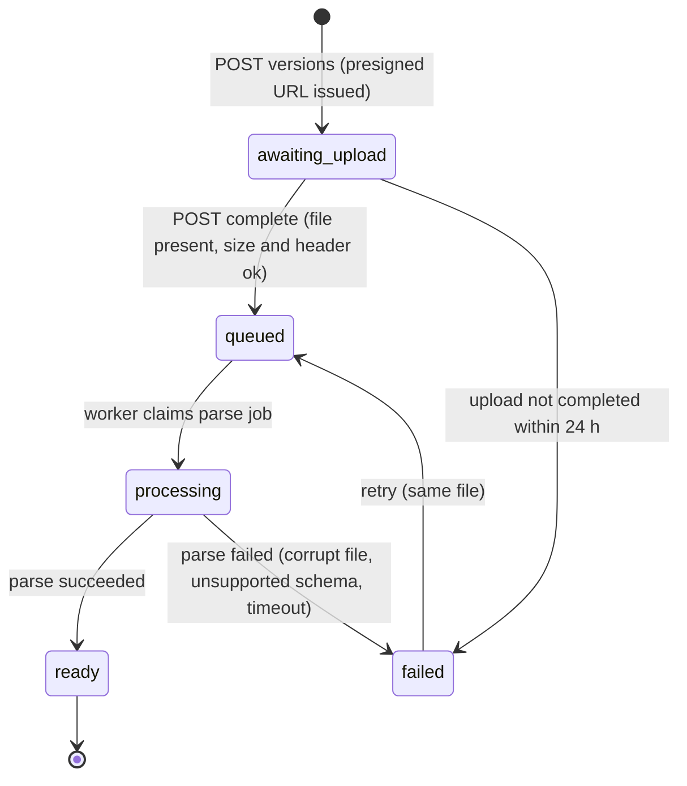
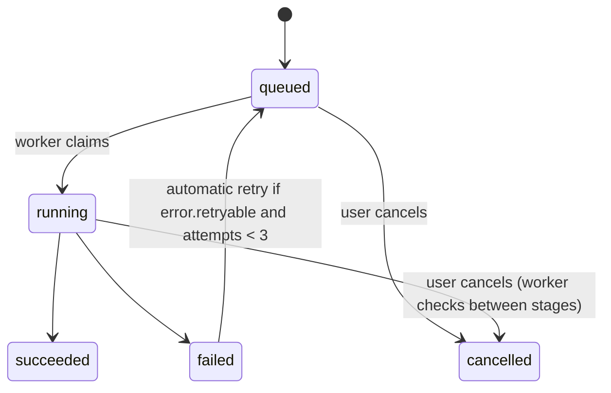
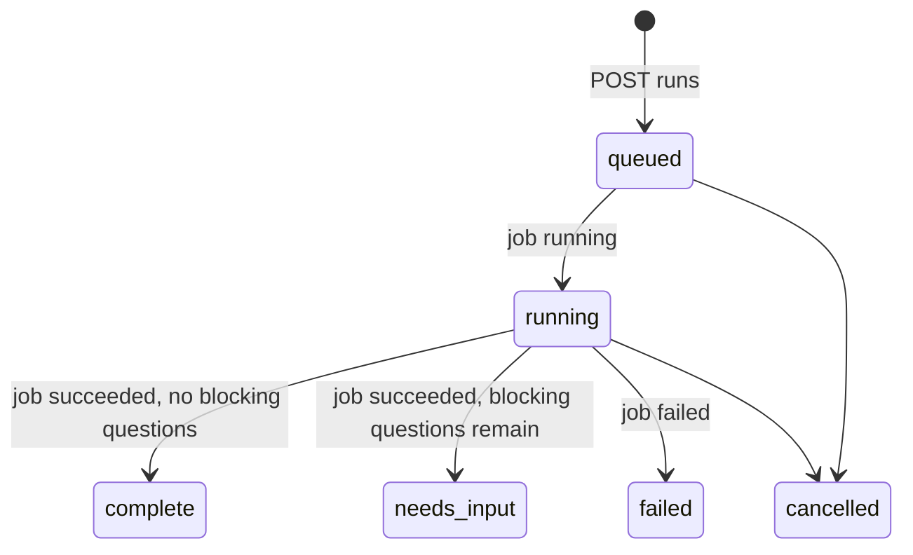
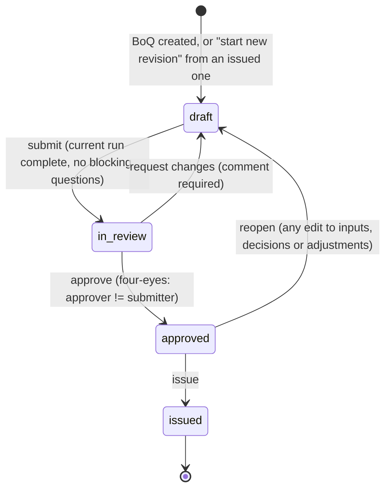
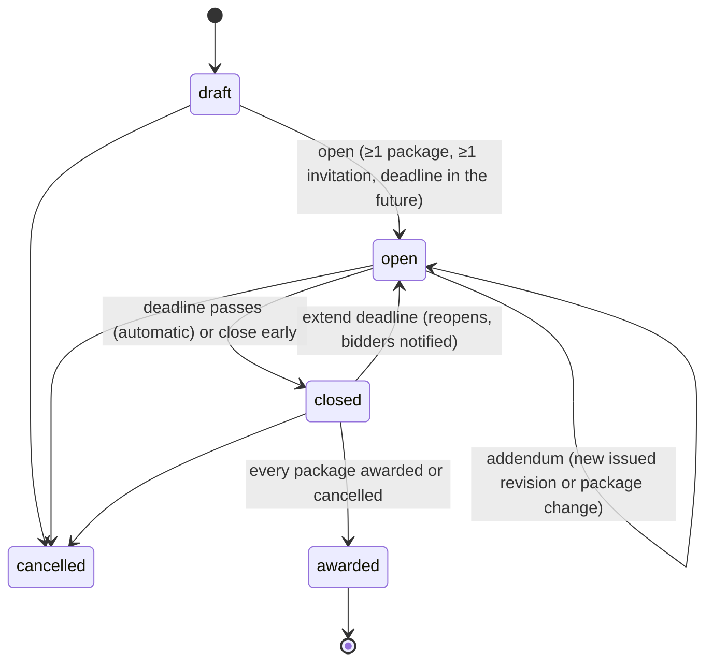
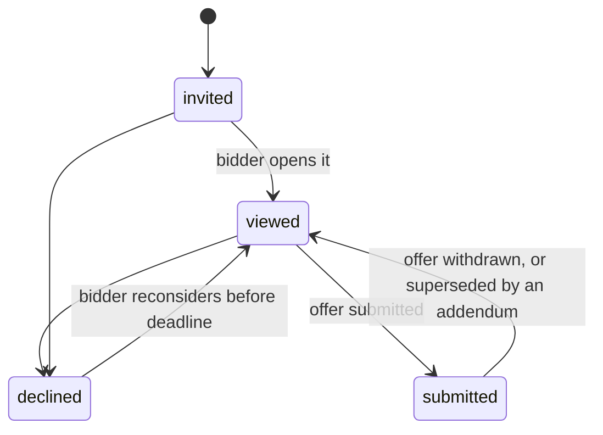

# State machines

Every lifecycle in the product. Transitions not drawn here are not allowed. The backend
rejects them with `409 invalid_transition` and names the current state.

## ModelVersion



- A `ready` version is immutable. Deleting is allowed only when no run references it (then it
  is soft-deleted).
- **Same content hash:** if a `ready` version with the same sha256 exists anywhere in the
  same org, the parse artifacts are reused and the version goes straight to `ready` (event
  still recorded).
- `failed.error.code`: `not_ifc`, `unsupported_schema`, `corrupt_file`, `too_large`,
  `parse_timeout`, `parse_error`.

## Job



A job never "needs input" (P13). It always ends.

## Run



Runs are immutable once finished. Answering a question doesn't change a run. The UI offers
"Re-generate", which creates a new run with the current decisions and adjustments. The
revision's `currentRunId` moves to the newest **finished** run (complete or needs_input).

## BoqRevision



Rules:
- **Edits allowed only in `draft`.** Changing inputs, overrides, manual items or project
  decisions that the current run uses, while the revision is `in_review` or `approved`, sends
  it back to `draft` (the UI warns first). Decisions are project-wide, so one answer can reopen
  several revisions; the UI lists which.
- **Submit preconditions:** `currentRunId` set, that run `complete` (no blocking questions),
  and it uses the current inputs, decisions and adjustments (no pending changes).
- **Issue** freezes: the run id, a copy of the adjustments, an Excel export, and a `frozen`
  record. After that nothing about the revision can change (`409 revision_locked`), not even by
  an org owner.
- **New revision:** allowed only when the BoQ's current revision is `issued`. Creates revision
  N+1 in `draft` with the same inputs, `basedOnRevisionId` = the issued one. The user then swaps
  in new model versions and re-generates.
- A BoQ has at most one non-issued revision at a time.

## Tender



- **Sealed tenders:** while `open`, the firm sees each invitation's status (invited, viewed,
  declined, submitted) and the submit time, but not rates or totals. At `closed` everything
  becomes visible.
- **Unsealed tenders:** offers are visible as soon as they are submitted.
- Opening sends invitations (emails). Invitations added later in `open` are sent immediately.

## TenderPackage

`open` → `awarded` (choose one submitted offer of the latest addendum) or `cancelled`.
Award is allowed only when the tender is `closed`. Award notifies every bidder invited to the
package.

## BidInvitation



## Offer

```mermaid
stateDiagram-v2
  [*] --> draft
  draft --> submitted: submit (before deadline)
  submitted --> draft: edit before deadline (becomes a new draft; the submitted one stays until re-submit)
  submitted --> withdrawn: withdraw before deadline
  submitted --> superseded: addendum affecting the package
  draft --> superseded: addendum affecting the package
```

- Submitting needs a rate on every line with a quantity, unless the tender allows partial
  offers (`Tender.allowPartial`, default false). Lines with null quantity may have a rate or
  stay empty.
- After an addendum, a new draft is created from the superseded offer. Rates are carried over
  for line keys that still exist with the same unit, and the bidder must submit again.
- After the deadline nothing changes. Late submission returns `409 deadline_passed`.
